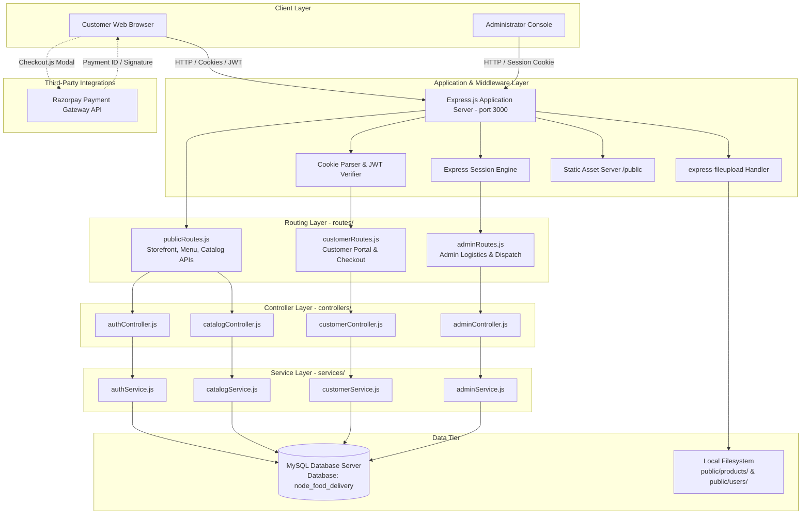
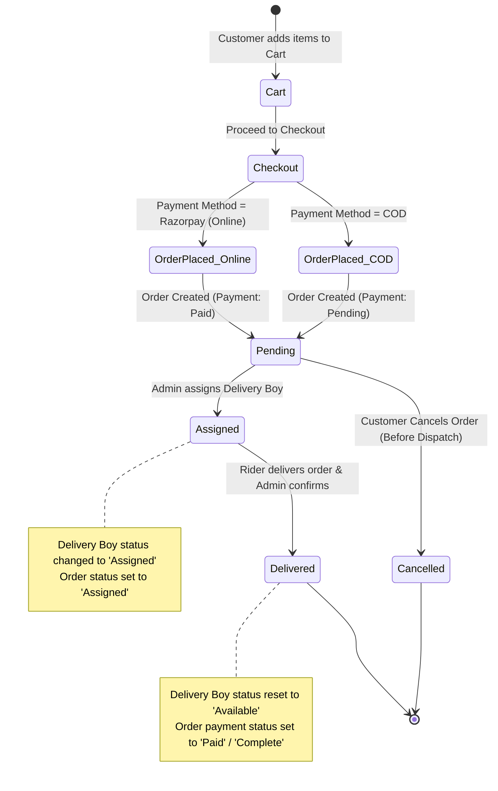
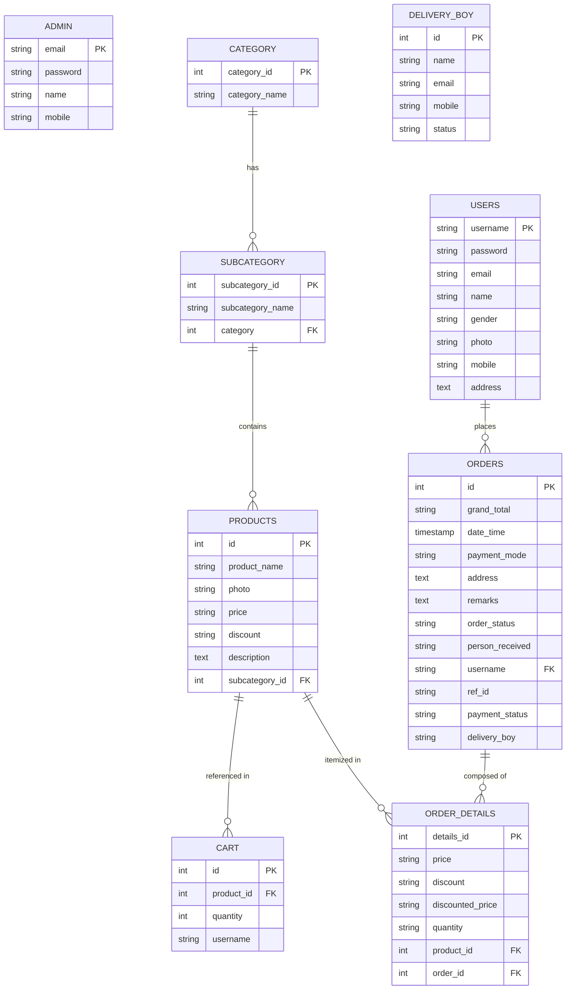
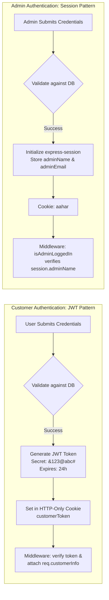
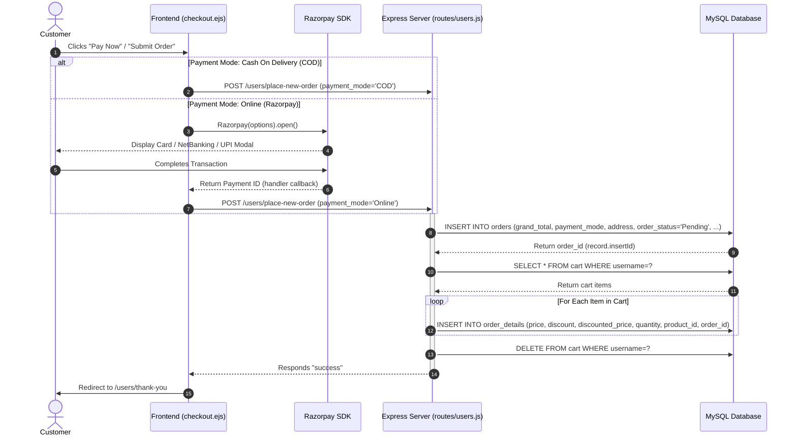

# 🍔 Aahar — Online Food Ordering & Delivery Management System

[](https://nodejs.org/)
[](https://expressjs.com/)
[](https://www.mysql.com/)
[](https://razorpay.com/)
[](#system-architecture)
[](LICENSE)

---

## 📖 Executive Summary

**Aahar** is a full-stack, enterprise-grade Online Food Ordering and Delivery Management platform built using **Node.js**, **Express.js**, **EJS**, and **MySQL**. The system bridges the gap between restaurant operations, customer orders, online payment processing, and logistics fulfillment.

Designed around a role-based access paradigm, Aahar supports two primary personas:
1. **Customers**: Browse menus by nested categories, manage real-time persistent shopping carts, place orders with flexible payment options (Razorpay Online Gateway & Cash on Delivery), and track order progress in real time.
2. **Administrators**: Control menu taxonomy (Categories & Subcategories), maintain product catalogs with automated image asset storage, monitor live order pipelines, assign orders to available delivery riders, and reconcile deliveries.

---

## 📑 Table of Contents

- [Executive Summary](#-executive-summary)
- [Key Features](#-key-features)
- [System Architecture](#-system-architecture)
  - [High-Level Architectural Diagram](#high-level-architectural-diagram)
  - [Order Lifecycle State Machine](#order-lifecycle-state-machine)
- [Technology Stack](#-technology-stack)
- [Database Schema & Data Model](#-database-schema--data-model)
  - [Entity Relationship Diagram (ERD)](#entity-relationship-diagram-erd)
  - [Data Dictionary](#data-dictionary)
- [Project Directory Structure](#-project-directory-structure)
- [API & Route Specifications](#-api--route-specifications)
  - [Public & Shared Endpoints](#1-public--shared-endpoints)
  - [Customer Endpoints (`/users` & `/`)](#2-customer-endpoints)
  - [Admin Endpoints (`/admin` & `/`)](#3-admin-endpoints)
- [Authentication & Session Architecture](#-authentication--session-architecture)
- [Order & Payment Workflow](#-order--payment-workflow)
- [Installation & Local Setup](#-installation--local-setup)
- [Default Demo Credentials](#-default-demo-credentials)
- [Configuration & Environment Variables](#-configuration--environment-variables)
- [Senior Engineer Audit & Production Hardening](#-senior-engineer-audit--production-hardening)
- [License](#-license)

---

## 🌟 Key Features

### 👤 Customer Experience
* **Dynamic Menu & Filtering**: Cascading AJAX filters allowing customers to filter dishes by Category $\rightarrow$ Subcategory without page refreshes.
* **Persistent Database Cart**: Cart state is persisted in MySQL (`cart` table) linked to the user account, ensuring cart state survives sessions and multi-device logins.
* **Quantity Controls & Stock Caps**: Increment, decrement, and remove cart items with built-in client and server caps (up to 5 units per line item).
* **Dual Payment Processing**:
  * **Razorpay Gateway**: Integrated checkout overlay handling test/production transactions.
  * **Cash on Delivery (COD)**: Instant checkout without prepayment.
* **Live Order History & Tracking**: Real-time status badges (`Pending` $\rightarrow$ `Assigned` $\rightarrow$ `Delivered`) and itemized receipt modal breakdowns.
* **Order Cancellation**: Self-service order cancellation for orders still in the `Pending` state.
* **Profile & Authentication**: JWT-secured login/signup with file upload for customer avatar images and secure password management.

### 🛡️ Admin & Operational Back-Office
* **Menu Taxonomy Management**:
  * Create, Read, Update, Delete (CRUD) for parent **Categories**.
  * Full CRUD for **Subcategories** with foreign key cascading to parent categories.
* **Product Catalog Engine**:
  * Add, update, and delete menu items with dynamic pricing, percentage discounts, calculated net pricing, and automatic image upload to `public/products/`.
* **Logistics & Delivery Fleet Management**:
  * Register delivery personnel (`delivery_boy` table) with contact details.
  * Real-time status toggling between `Available` and `Assigned`.
* **Three-Stage Order Pipeline**:
  * **Pending Queue**: Real-time order queue with one-click rider assignment.
  * **Assigned / In-Transit Queue**: Out-for-delivery dashboard tracking rider assignment, with recipient confirmation and delivery reconciliation.
  * **Delivered Archive**: History log of fulfilled orders with customer info, delivery timestamps, and payment statuses.
* **Admin Security**: Session-backed administrative authentication with password update utilities.

---

## 🏗️ System Architecture

### High-Level Architectural Diagram



### Order Lifecycle State Machine



---

## 💻 Technology Stack

| Layer | Technology | Version | Purpose |
| :--- | :--- | :--- | :--- |
| **Runtime** | [Node.js](https://nodejs.org/) | `>= 14.x` | Server-side JavaScript runtime environment |
| **Web Framework** | [Express.js](https://expressjs.com/) | `4.16.1` | RESTful API routing, middleware execution, HTTP server |
| **Template Engine** | [EJS](https://ejs.co/) | `2.6.1` | Server-Side Rendering (SSR) of views and components |
| **Database** | [MySQL](https://www.mysql.com/) | `8.0+` | Relational storage for users, catalog, cart, orders, and fleet |
| **DB Client** | [mysql (npm)](https://www.npmjs.com/package/mysql) | `2.18.1` | Connection pool & native SQL query executor |
| **Authentication (User)** | [JSON Web Token](https://jwt.io/) | `9.0.2` | Stateless HTTP-only cookie-based authentication token |
| **Authentication (Admin)**| [express-session](https://www.npmjs.com/package/express-session) | `1.18.0` | Stateful cookie-session authentication for admin console |
| **File Uploads** | [express-fileupload](https://www.npmjs.com/package/express-fileupload) | `1.4.0` | Multi-part form data parser for images (products & avatars) |
| **Payment Gateway** | [Razorpay](https://razorpay.com/) | Checkout SDK v1 | Digital checkout & card/UPI/net-banking payment provider |
| **Logging** | [Morgan](https://github.com/expressjs/morgan) | `1.9.1` | HTTP request logging for development & debugging |
| **Client UI Framework** | Bootstrap | `4.x / 5.x` | Responsive grid, utility classes, and components |
| **Client Scripts** | jQuery + jQuery Validation | `1.19.5` | DOM manipulation, AJAX async calls, and form validations |
| **UI Notifications** | [SweetAlert2](https://sweetalert2.github.io/) | `11.x` | Alert notifications, confirmation modals, error prompts |
| **Printing / Invoicing**| [printThis](https://jasont-style.github.io/printThis/) | `1.15.x` | Client-side DOM printing for invoice generation |

---

## 🗄️ Database Schema & Data Model

### Entity Relationship Diagram (ERD)



### Data Dictionary

1. **`admin`**: System administrator credentials.
   * `email` (`VARCHAR(100)`, PK): Administrator unique login ID.
   * `password` (`VARCHAR(100)`): Account password.
   * `name` (`VARCHAR(60)`), `mobile` (`VARCHAR(15)`): Admin contact identity.
2. **`category`**: Top-level restaurant item classification (e.g., *Biryani*, *Parantha*, *Beverages*).
   * `category_id` (`INT`, PK, Auto-Increment), `category_name` (`VARCHAR(100)`).
3. **`subcategory`**: Granular item grouping linked to parent category (e.g., *Stuffed Parantha*, *Chicken Biryani*).
   * Foreign Key: `category` $\rightarrow$ `category(category_id)` on delete CASCADE.
4. **`products`**: Food items available on the menu.
   * `price` (`VARCHAR(10)`): Base price in INR ($\text{\rupee}$).
   * `discount` (`VARCHAR(10)`): Discount percentage ($0-100\%$).
   * `photo` (`VARCHAR(150)`): Relative filesystem asset path.
   * Foreign Key: `subcategory_id` $\rightarrow$ `subcategory(subcategory_id)` on delete CASCADE.
5. **`users`**: Registered customer accounts.
   * `username` (`VARCHAR(100)`, PK): Unique customer identifier.
   * `photo`, `mobile`, `address`: Shipping and identification profile information.
6. **`cart`**: Persistent user shopping carts.
   * `product_id`: Associated menu item.
   * `quantity`: Number of items selected.
   * `username`: Cart owner identifier.
7. **`orders`**: Master purchase order headers.
   * `order_status`: Lifecycle status (`Pending`, `Assigned`, `Delivered`, `Cancelled`).
   * `payment_mode`: `COD` or `Online`.
   * `payment_status`: `Pending`, `Paid`, or `Complete`.
   * `delivery_boy`: ID of assigned delivery rider.
   * Foreign Key: `username` $\rightarrow$ `users(username)`.
8. **`order_details`**: Itemized lines snapshotting prices at time of order creation.
   * `discounted_price`: Computed line item price after discount.
   * Foreign Keys: `product_id` $\rightarrow$ `products(id)` on delete CASCADE, `order_id` $\rightarrow$ `orders(id)` on delete CASCADE.
9. **`delivery_boy`**: Logistics delivery staff.
   * `status`: `Available` or `Assigned`.

---

## 📁 Project Directory Structure

```text
Online Food Ordering/
├── config/                          # Application configuration modules
│   └── db.js                        # MySQL database connection client
├── controllers/                     # HTTP Request Handlers (Req/Res orchestration)
│   ├── adminController.js           # Admin HTTP endpoints
│   │── authController.js            # Authentication HTTP endpoints
│   ├── catalogController.js         # Catalog & cart HTTP endpoints
│   └── customerController.js        # Storefront & orders HTTP endpoints
├── services/                        # Business Logic & Database Queries (3-Tier Layer)
│   ├── adminService.js              # Fleet, order dispatch & status operations
│   ├── authService.js               # Password checks, credential validation & registration
│   ├── catalogService.js            # Category, subcategory, product & cart SQL queries
│   └── customerService.js           # Order checkout, line itemization & user order history
├── middlewares/                     # Express middleware pipeline
│   └── authMiddleware.js            # JWT customer & session admin authorization guards
├── routes/                          # Route definitions connecting URLs to controllers
│   ├── adminRoutes.js               # Admin routes (/admin/*)
│   ├── customerRoutes.js            # Customer portal routes (/users/*)
│   ├── publicRoutes.js              # Public storefront & catalog routes (/*)
│   └── index.js                     # Central application router aggregator
├── tests/                           # Automated Test Suite (Native node:test runner)
│   └── app.test.js                  # Comprehensive baseline regression integration tests
├── public/                          # Public static directory served via express.static
│   ├── aahar.png                    # Application primary logo
│   ├── aahar-2.png                  # Secondary brand emblem
│   ├── cart.jpg                     # Empty cart illustration placeholder
│   ├── error-img.png                # 404 error page graphic
│   ├── assets/                      # Template CSS, JS, Fonts, and Plugin assets
│   ├── bootstrap/                   # Bootstrap runtime assets
│   ├── javascripts/                 # Client utilities (e.g. jQuery)
│   ├── printThis/                   # Invoice print plugin
│   ├── products/                    # User-uploaded food menu photographs
│   ├── stylesheets/                 # Global styles and overrides
│   └── users/                       # User-uploaded customer avatar photographs
├── views/                           # Embedded JavaScript (EJS) presentation views
│   ├── admin/                       # Admin management templates
│   │   ├── delivered_order.ejs      # Fulfilled orders view
│   │   ├── delivery-boy.ejs         # Fleet management view
│   │   ├── manage_orders.ejs        # Pending orders & dispatch modal
│   │   ├── order_details.ejs        # Order item details template
│   │   └── shipped_orders.ejs       # In-transit orders & delivery completion view
│   ├── components/                  # Reusable UI partials
│   │   ├── banner.ejs               # Hero carousel banner
│   │   ├── menu.ejs                 # Featured menu section
│   │   └── tableHeading.ejs         # Common dynamic table header partial
│   ├── users/                       # Customer portal templates
│   │   ├── change_password.ejs      # Customer password change form
│   │   ├── customer-bread-crumb.ejs # Customer navigation breadcrumb
│   │   ├── my_orders.ejs            # Order history listing & cancellation UI
│   │   ├── my_orders_details.ejs    # Itemized order details view
│   │   ├── thank_you.ejs            # Post-checkout order confirmation
│   │   ├── user_home.ejs            # Customer dashboard home
│   │   └── user_navbar.ejs          # Customer authenticated navigation bar
│   ├── bread-crumb.ejs              # Global breadcrumb component
│   ├── category.ejs                 # Admin Category management view
│   ├── checkout.ejs                 # Checkout and payment integration page
│   ├── footer.ejs                   # Global footer component
│   ├── footer_scripts.ejs           # JavaScript dependencies & global cart counter
│   ├── guest_navbar.ejs             # Public / non-authenticated navigation bar
│   ├── header-files-new.ejs         # Global CSS stylesheet imports
│   ├── index.ejs                    # Landing page / storefront
│   ├── menu.ejs                     # Interactive food menu with category filter
│   ├── navbar.ejs                   # Admin navigation bar
│   ├── pageNotFound.ejs             # Custom 404 error page
│   ├── pdf.ejs                      # Printable invoice view
│   ├── products.ejs                 # Admin Product management view
│   ├── shopping-cart.ejs            # Interactive cart view & quantity editor
│   ├── sub_category.ejs             # Admin Subcategory management view
│   ├── top-header.ejs               # Brand contact and promotion top banner
│   ├── user_login.ejs               # Customer authentication login view
│   └── user_signup.ejs              # Customer registration view
├── app.js                           # Express application & HTTP server entry point
├── connection.js                    # Database connection export (backward-compatibility)
├── node_food_delivery.sql           # Database schema dump with initial sample data
├── package.json                     # Project manifest (scripts: start, dev, test)
└── .gitignore                       # Production gitignore rules
└── package-lock.json                # Locked dependency tree
```

---

## 📡 API & Route Specifications

### 1. Public & Shared Endpoints

| Method | Endpoint | Description | Auth Required |
| :--- | :--- | :--- | :--- |
| `GET` | `/` | Storefront landing page with featured sections | None |
| `GET` | `/menu` | Interactive catalog with category/subcategory selector | None |
| `GET` | `/user-login` | Customer login view | None |
| `POST` | `/user-login` | Authenticate customer and issue `customerToken` cookie | None |
| `GET` | `/user-signup` | Customer registration view | None |
| `POST` | `/user-signup` | Register new user account with photo upload | None |
| `GET` | `/admin-login` | Admin login view | None |
| `POST` | `/admin-login` | Authenticate admin and initialize session | None |
| `GET` | `/get-category-from-server` | Fetch all food categories as JSON | None |
| `GET` | `/fetch-subcategory-related-to-category`| Query subcategories matching `?category_id=` | None |
| `GET` | `/get-products-according-to-sub-category` | Query products matching `?id=` (subcategory ID) | None |
| `GET` | `/get-products` | Fetch all products list | None |

### 2. Customer Endpoints

| Method | Endpoint | Description | Auth Required |
| :--- | :--- | :--- | :--- |
| `GET` | `/users/` | Customer personal dashboard | JWT (`customerToken`) |
| `POST` | `/cart-count` | Returns active cart line item count | JWT (`customerToken`) |
| `POST` | `/add-to-cart` | Handle cart actions: `add`, `plus`, `minus`, `remove`, `get-products` | JWT (`customerToken`) |
| `GET` | `/shopping-cart` | Interactive cart view | JWT (`customerToken`) |
| `GET` | `/checkout` | Checkout view with address and payment method selection | JWT (`customerToken`) |
| `POST` | `/users/place-new-order` | Process checkout form, persist order, itemize records & flush cart | JWT (`customerToken`) |
| `GET` | `/users/thank-you` | Order success confirmation page | JWT (`customerToken`) |
| `GET` | `/users/my-orders` | Customer order history view | JWT (`customerToken`) |
| `GET` | `/users/fetch-my-order` | Fetch orders for authenticated customer as JSON | JWT (`customerToken`) |
| `GET` | `/users/order-details` | View itemized dishes and prices for order (`?order_id=`) | JWT (`customerToken`) |
| `GET` | `/users/cancel-order` | Cancel an order (`?id=`) if still in `Pending` state | JWT (`customerToken`) |
| `POST` | `/user-change-password` | Update customer account password | Session / Form |
| `GET` | `/users/logout` | Invalidate customer JWT cookie and redirect to login | JWT (`customerToken`) |

### 3. Admin Endpoints

| Method | Endpoint | Description | Auth Required |
| :--- | :--- | :--- | :--- |
| `GET` | `/admin-home` | Admin dashboard overview | Session (`adminName`) |
| `GET` | `/manage-category` | Category management view | Session (`adminName`) |
| `POST` | `/add-category` | Create a new food category | Session (`adminName`) |
| `POST` | `/update-category` | Modify category name | Session (`adminName`) |
| `POST` | `/delete-category` | Delete category by `category_id` | Session (`adminName`) |
| `GET` | `/manage-sub-category` | Subcategory management view | Session (`adminName`) |
| `POST` | `/add-sub-category` | Create subcategory with parent category ID | Session (`adminName`) |
| `POST` | `/update-sub-category` | Update subcategory name or parent category | Session (`adminName`) |
| `GET` | `/delete-sub-category` | Delete subcategory by `?id=` | Session (`adminName`) |
| `GET` | `/manage-product` | Product catalog management view | Session (`adminName`) |
| `POST` | `/add-product` | Create product with photo upload & category binding | Session (`adminName`) |
| `POST` | `/delete-product` | Delete product by `product_id` | Session (`adminName`) |
| `GET` | `/admin/manage-delivery-boy` | Fleet management dashboard | Session (`adminName`) |
| `GET` | `/admin/fetchDeliveryBoys` | Fetch all available delivery riders | Session (`adminName`) |
| `POST` | `/add-delivery-boy` | Register a new delivery rider | Session (`adminName`) |
| `GET` | `/admin/pending-orders` | View orders pending delivery assignment | Session (`adminName`) |
| `GET` | `/admin/fetch-pending-order`| Query JSON list of all pending orders | Session (`adminName`) |
| `POST` | `/admin/assign-delivery-boy-to-order` | Bind rider to order; change rider status to `Assigned` | Session (`adminName`) |
| `GET` | `/admin/assigned-orders` | View orders currently in-transit | Session (`adminName`) |
| `GET` | `/admin/fetch-shipped-order`| Query JSON list of all assigned/in-transit orders | Session (`adminName`) |
| `GET` | `/admin/deliver-food-now/:order_id/:db_id` | Mark order `Delivered`, payment `Paid`, and rider `Available` | Session (`adminName`) |
| `GET` | `/admin/delivered-orders` | Archive view of completed deliveries | Session (`adminName`) |
| `GET` | `/admin/fetch-delivered-order` | Query JSON list of all delivered orders | Session (`adminName`) |
| `GET` | `/logout-admin` | Clear admin session | Session (`adminName`) |

---

## 🔐 Authentication & Session Architecture

The application adopts a dual-strategy security model separating customer and administrator privileges:



### Authorization Middlewares

1. **`authorizeCustomerForViews(req, res, next)`**:
   * Inspects `req.cookies.customerToken`.
   * Verifies the cryptographic signature. If invalid or absent, redirects the user to `/user-login`.
   * Populates `req.customerInfo` with `{ fullname, mobile, userName }`.
2. **`authorizeCustomerForPOST(req, res, next)`**:
   * Protects AJAX/POST operations. If the token is invalid or missing, immediately halts processing and responds with the string `"jwt"`, triggering client-side redirects to login.
3. **`authorizeCustomerForPublicViews(req, res, next)`**:
   * Permissive middleware for public pages (e.g. Home, Menu). Sets `req.customerInfo = null` if unauthenticated, allowing dynamic rendering of either `user_navbar` or `guest_navbar`.
4. **`isAdminLoggedIn(req, res, next)`**:
   * Verifies that `session.adminName` is defined. Redirects unauthorized attempts to `/admin-login`.

---

## 💳 Order & Payment Workflow



---

## ⚙️ Installation & Local Setup

### Prerequisites
* [Node.js](https://nodejs.org/) (Version `14.x`, `16.x`, `18.x`, or `20.x`)
* [npm](https://www.npmjs.com/) (Version `6.x` or higher)
* [MySQL Server](https://dev.mysql.com/downloads/mysql/) (Version `8.0` recommended)

---

### Step 1: Clone or Open the Workspace

Open your terminal or command prompt and navigate to the project directory:

```bash
cd "d:/__VMM__/___Student Projects___/Node Js/__6 Month Projects__/Online Food Ordering"
```

---

### Step 2: Install Node Dependencies

Execute `npm install` to download all required production and development dependencies:

```bash
npm install
```

---

### Step 3: Configure and Import the MySQL Database

1. Ensure your MySQL server service is running.
2. Open your preferred database tool (MySQL Workbench, phpMyAdmin, or the MySQL CLI).
3. Create the database:
   ```sql
   CREATE DATABASE node_food_delivery;
   ```
4. Import the provided schema and seed data from `node_food_delivery.sql`:
   ```bash
   mysql -u root -p node_food_delivery < node_food_delivery.sql
   ```
   *(If prompted, enter your MySQL root password).*

---

### Step 4: Verify Database Connection Configuration

Open `connection.js` in your editor and verify that host, port, user, and password match your local MySQL configuration:

```javascript
const mysql = require("mysql");

const connection = mysql.createConnection({
    host: "localhost",
    user: "root",
    password: "your_password",    // Replace with your MySQL password (default in repo: "system")
    database: "node_food_delivery",
    port: 3306                    // Adjust port (default in repo: 3308; standard MySQL: 3306)
});
```

> [!IMPORTANT]
> If your local MySQL service runs on the standard port `3306`, update line 8 of `connection.js` from `3308` to `3306`.

---

### Step 5: Start the Application

#### Development Mode (with Hot Reloading via Nodemon):
```bash
npm run dev
```

#### Production Mode:
```bash
npm start
```

Once started, the console will output:
```text
Database Connection Created
Listening on port 3000
```

Open your browser and navigate to:
```text
http://localhost:3000
```

---

## 🔑 Default Demo Credentials

Pre-seeded credentials available from `node_food_delivery.sql`:

### 👑 Administrator Console
* **URL**: [http://localhost:3000/admin-login](http://localhost:3000/admin-login)
* **Email**: `admin@gmail.com`
* **Password**: `123`

### 👤 Customer Accounts
* **URL**: [http://localhost:3000/user-login](http://localhost:3000/user-login)
* **Account 1**:
  * **Username**: `user1`
  * **Password**: `123`
* **Account 2**:
  * **Username**: `user2`
  * **Password**: `123`

---

## ⚙️ Configuration & Environment Variables

For production deployments, decouple hardcoded values into a `.env` configuration file using [`dotenv`](https://www.npmjs.com/package/dotenv).

Recommended `.env` template:

```env
# Server Configuration
PORT=3000
NODE_ENV=production

# Database Configuration
DB_HOST=localhost
DB_USER=root
DB_PASSWORD=your_secure_password
DB_NAME=node_food_delivery
DB_PORT=3306

# Authentication Secrets
JWT_SECRET=your_super_secret_jwt_key_here
SESSION_SECRET=your_super_secret_session_key_here

# Payment Gateway (Razorpay)
RAZORPAY_KEY_ID=rzp_test_dRWiKHS7zr2Gki
RAZORPAY_KEY_SECRET=your_razorpay_secret_key
```

---

## 🧪 Automated Testing Suite

The application includes a comprehensive test suite powered by Node.js native test runner (`node:test`) and [Supertest](https://www.npmjs.com/package/supertest), covering **66 automated tests across 14 test suites**:

```bash
npm test
```

### Coverage Overview:
1. **Golden Master Baseline (`tests/app.test.js`)**:
   - Public view routes and custom 404 handler
   - Public catalog & delivery boy APIs
   - Customer and Admin authentication rejection and success
   - JWT and Session middleware protections
2. **End-to-End User Journeys (`tests/e2e_flows.test.js`)**:
   - **Client Registration & Validation**: Form validation, multipart avatar upload, duplicate username prevention
   - **Shopping Cart & Checkout**: Real-time cart calculations, quantity increment/decrement, and checkout rendering
   - **Order Lifecycle**: Order placement, itemization into `order_details`, cart flushing, and customer order cancellation
   - **Client Security**: Old password verification, password updates, and session logout
   - **Admin Management**: Full CRUD for categories and subcategories, delivery fleet management
   - **Logistics & Dispatch**: Order assignment to delivery personnel, order status updates (`Pending` -> `Assigned` -> `Delivered`), delivery boy availability recycling
   - **Admin Security**: Password verification and update idempotency, admin session invalidation

---

## 🛡️ Senior Engineer Audit & Production Hardening

As a production-grade software evaluation, the following architectural upgrades and security hardening steps are strongly recommended before deploying Aahar to a public cloud environment:

### 1. Password Hashing with Bcrypt
* **Current State**: Passwords in `users` and `admin` tables are currently stored in plaintext.
* **Remediation**: Implement `bcrypt` or `argon2` with a work factor of $\ge 10$:
  ```javascript
  const bcrypt = require("bcrypt");
  const hashedPassword = await bcrypt.hash(rawPassword, 10);
  const isValid = await bcrypt.compare(candidatePassword, hashedPassword);
  ```

### 2. SQL Parameterization (Preventing SQL Injection)
* **Current State**: Several query routes utilize string interpolation (e.g., ``WHERE id=${oid}``).
* **Remediation**: Use placeholder arrays across all queries:
  ```javascript
  // Recommended
  connection.query("UPDATE orders SET person_received=?, order_status=? WHERE id=?", [name, "Delivered", oid], callback);
  ```

### 3. Distributed Session Store
* **Current State**: `express-session` uses default MemoryStore, which leaks memory in production and cannot scale horizontally.
* **Remediation**: Use `connect-redis` or `express-mysql-session` to maintain stateful sessions across multiple container instances.

### 4. Server-Side Razorpay Signature Verification
* **Current State**: Frontend invokes `orderNow('Online')` upon client-side callback.
* **Remediation**: Implement Razorpay Webhook or backend verification endpoint using HMAC SHA256 signature validation before marking payment status as `Paid`:
  ```javascript
  const crypto = require("crypto");
  const expectedSignature = crypto
    .createHmac("sha256", process.env.RAZORPAY_KEY_SECRET)
    .update(razorpay_order_id + "|" + razorpay_payment_id)
    .digest("hex");
  ```

### 5. File Upload Sanitization & Cloud Storage
* **Current State**: Files are uploaded to local `public/` directories with original file names.
* **Remediation**: Validate MIME types (magic bytes), restrict allowed extensions (`.jpg`, `.jpeg`, `.png`, `.webp`), generate cryptographically random file names (UUID v4), and offload asset storage to an S3-compatible object store (e.g., AWS S3, Cloudflare R2).

### 6. Security Headers & Rate Limiting
* Integrate [Helmet.js](https://helmetjs.github.io/) to enforce secure HTTP headers (CSP, HSTS, X-Content-Type-Options).
* Integrate `express-rate-limit` on `/user-login`, `/admin-login`, and `/user-signup` to prevent brute-force attacks.

---

## 📄 License

This project is open-source and distributed under the **MIT License**.

---

<div align="center">
  <sub>Built with ❤️ by Senior Engineering Team for the Aahar Food Delivery Ecosystem.</sub>
</div>
